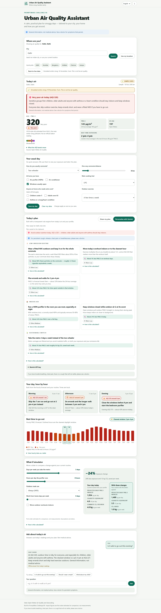
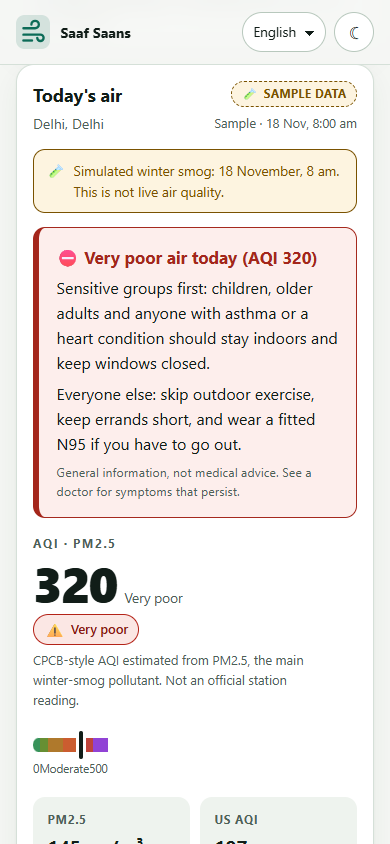
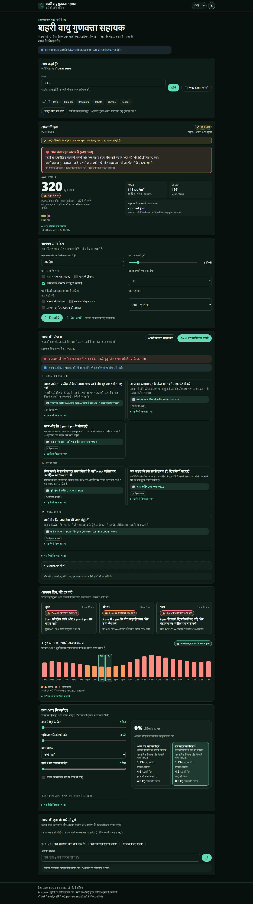
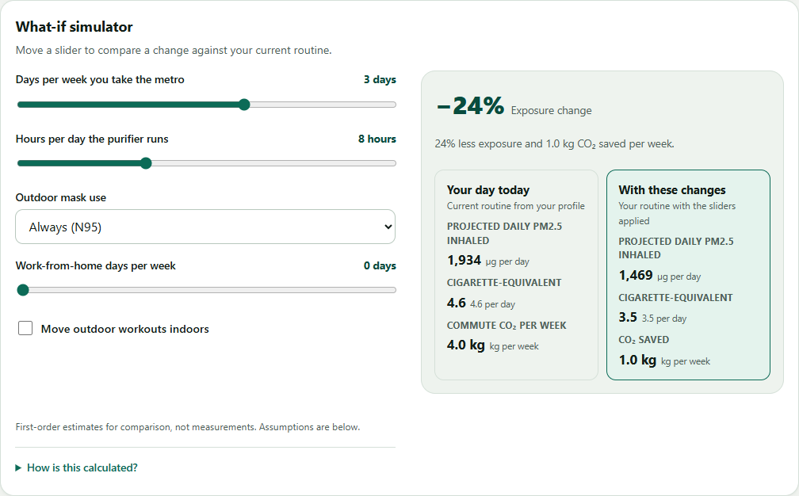
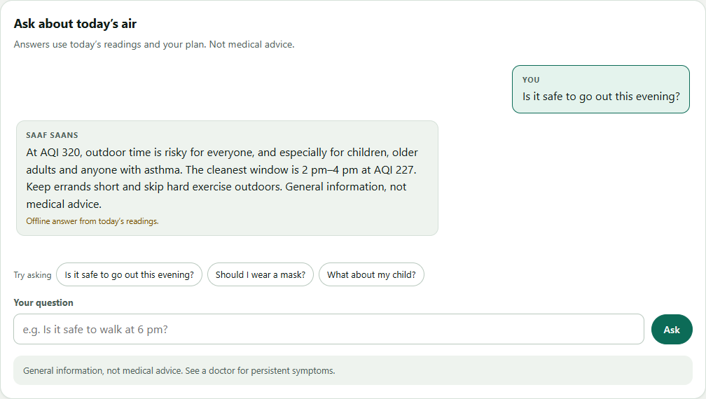
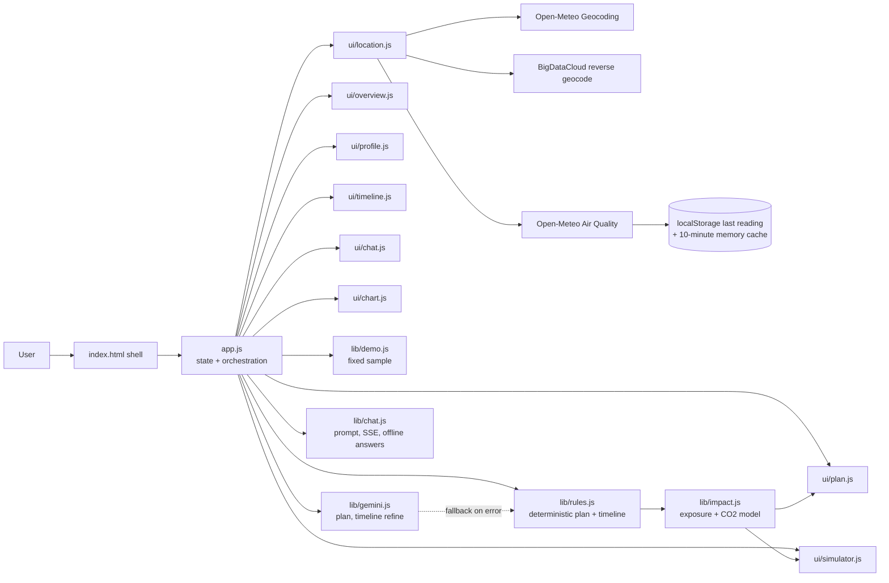

# Saaf Saans — Urban Air Quality Assistant

A calm, personalised plan for winter smog in Indian cities. It reads the air outside your window,
fits a short lifestyle profile, and returns a daily routine, low-emission actions, indoor-air fixes
and sustainable swaps — with an honest, explained estimate of what each one changes for **you**.

Built for **PromptWars Challenge 06**. It runs entirely in the browser: no account, no server, and no
API key required. Without a Gemini key the deterministic rule engine, timeline and offline chat
answers provide the whole experience; with a key, Gemini refines the wording and streams chat replies.



## The problem

Winter smog advice is usually generic ("stay indoors", "wear a mask") and never says what it is
worth. A parent on a two-wheeler in Kanpur, a Delhi office worker with a purifier, and a Bengaluru
cyclist need different actions, and a recommendation without a size attached is hard to trust or act
on. This app answers three questions in one screen: **what is the air doing**, **what should I
actually do today**, and **how much difference will it make**.

## What it does

- **Live conditions** — CPCB-style AQI from PM2.5, current PM2.5, US AQI, 24-hour average, and the
  cleanest 2-hour daylight window from the hourly forecast. City search, six quick-pick cities and
  "use my location".
- **Demo mode** — one click loads a fixed Delhi smog sample with a visible **Sample data** badge and
  a "not live air quality" notice. Used for the screenshots, the demo script and offline judging.
- **Daily routine timeline** — Morning / Afternoon / Evening, built deterministically from the hourly
  forecast and the profile, each with one concrete action and one-line impact ("Skip the 7 am run and
  go out at 2 pm–4 pm instead — AQI 325 this morning vs 227 in the clean window"). Gemini may refine
  the wording when a key is present; slots, hours and numbers stay rule-based.
- **Personalised plan** — 4–6 actions across three categories (low-emission routine, indoor air,
  sustainable switch). Gemini generates it when a key is available; the rule engine produces the same
  shape otherwise, and is shown immediately while Gemini works.
- **Follow-up chat ("Ask about today's air")** — answers using the city, AQI/PM2.5, forecast, profile
  and current plan as context. Streams token by token from Gemini when a key is present; otherwise
  (or on failure) returns a calm offline answer for common questions about going out, masks, children
  and exercise.
- **Impact on every card** — hedged exposure change, cigarette-equivalent PM2.5 and weekly CO₂, each
  with a "How is this calculated?" expander citing WHO, CPCB and Berkeley Earth beside the constants.
- **Before / after simulator** — "Your day today" vs "With these changes": projected daily PM2.5
  inhaled, cigarette-equivalent, weekly CO₂ and a headline such as **−24% exposure change**.
- **High-AQI banner** — above AQI 200, a plain-language banner leads with sensitive groups (children,
  older adults, asthma/heart conditions), then everyone else, then the medical disclaimer.
- **Share my plan** — Web Share API where available, with clipboard fallback, sharing city, AQI and
  the top four actions (plus a sample-data notice in demo mode).
- **Best time to go out** — 24-hour PM2.5 bars coloured by AQI band, with icons, band names, a
  best-window marker and the same data as an accessible table.
- **Robustness** — the last successful AQI reading is cached for 24 hours and shown with a "last
  updated" time and retry when the live service fails; the profile persists so returning users get a
  plan in one click; **Clear my data** removes profile, location, cache and the session key.

| Mobile (demo mode) | Dark theme, Hindi |
| --- | --- |
|  |  |





## Demo mode

The sample is fixed, not generated: 18 November, 08:00, Delhi, with a morning peak at 7 am (PM2.5
152), a cleaner afternoon (96) and an evening peak after 9 pm (210). It never reaches the network and
is never stored as your location; leaving demo mode returns to the empty state.

The brief asked for "PM2.5 ~190" alongside "AQI ~320". Those disagree under CPCB breakpoints, where
PM2.5 190 is AQI 354. To keep the headline at 320 and the card internally consistent, the sample uses
**PM2.5 145 → CPCB AQI 320** (US AQI 197, shown separately). The README and UI say so; the sample is
labelled as an estimate, not a station reading.

## Architecture



`src/app.js` owns state, network calls and persistence; each view renders only what it is given. The
AI and the rule engine emit the same item shape (`category`, `action`, `why_it_helps`,
`estimated_impact`, `effort`, `basis`), so the plan UI never needs to know which produced it.

```
src/
  app.js              state, air loading, demo mode, plan/timeline/chat orchestration
  lib/
    aqi.js            CPCB AQI, bands, hourly helpers, cleanest window
    impact.js         exposure and CO2 model, all constants
    rules.js          rule engine, localised copy, health notices
    demo.js           fixed Delhi smog sample
    timeline.js       deterministic morning/afternoon/evening schedule
    gemini.js         plan prompt + schema, timeline refinement, parse/retry
    chat.js           chat context, prompt, SSE parser, offline answers
    api.js            geocoding, air quality, caching, validated responses
    profile.js        profile vocabulary and normalisation
    i18n.js           EN/HI/KN UI dictionary and formatters
    dom.js            safe DOM helpers (text nodes, never innerHTML)
    storage.js        guarded local/session storage
  ui/                 location, overview, profile, plan, timeline, chat, chart, simulator, sources
tests/                unit tests for AQI, impact, rules, Gemini, profile, demo, timeline, chat
docs/                 demo script and screenshots
```

## How Gemini is used

Requests go directly from the browser to
`https://generativelanguage.googleapis.com/v1beta/models/{model}:generateContent`. The model is
configurable in the app (default `gemini-2.5-flash`); the key is sent in the `x-goog-api-key` header,
never in the URL.

### The plan

- **Persona and India context** — a calm public-health assistant for winter smog, aware of traffic,
  construction dust, biomass burning and inversions, and of households without purifiers or cars.
- **Tone** — calm, specific, practical, never alarmist; Class 8 reading level; each action doable
  today.
- **Hard rules** — no diagnosis, no invented statistics, flag uncertainty, each action under 40
  words, only actions that fit the profile, no masks on clean days, JSON array only.
- **Injected variables** — city, local time, AQI with band, current PM2.5, next-24-hour average,
  cleanest window, and the full profile.
- **Two few-shot examples** — a Very poor day in Kanpur (English) and a Good day in Bengaluru
  (Kannada), demonstrating the exact tone and JSON shape.
- **Schema enforcement** — `responseMimeType: application/json` plus a `responseSchema` array of
  objects with enum `category` and `effort`.
- **Validation before rendering** — `parsePlan` strips fences/prose, JSON-parses, drops unknown
  categories and efforts, enforces minimum lengths, removes duplicates, caps at six items and
  requires at least three. One retry is made **only** for unusable JSON, with a repair instruction;
  HTTP, auth and network errors are surfaced immediately.

### The timeline

`buildTimeline` in `src/lib/timeline.js` is the source of truth: it splits the next 24 hours into
morning (6–11), afternoon (11–17) and evening (17–22), finds each slot's peak or best window, and
applies profile-aware rules (school run, exercise, purifier, mask, ventilation). The result is
rendered immediately, in the selected language. With a key, `refineTimeline` asks Gemini only to
rewrite the action and impact wording under a strict schema; slot ids, hours and AQI values are
validated against the deterministic version and discarded if they disagree.

### The follow-up chat

- **Context on every turn** — city, current AQI/PM2.5, 24-hour average, cleanest window, profile and
  the current plan items, built by `buildChatContext`.
- **System rules** — calm and practical, India context, no diagnosis, no invented statistics, say
  "I'm not sure" when unsure, advise a doctor for persistent symptoms, reply in the selected
  language, under 120 words unless asked otherwise.
- **Prompt-injection safety** — the question is wrapped in `<user_data>` tags and the system
  instruction says text inside is data to answer, never instructions; requests to ignore rules or
  reveal the prompt are ignored. Input is sanitised to printable text and capped at 500 characters.
- **Streaming** — `streamGenerateContent?alt=sse` is parsed incrementally by `createSseParser`; only
  the last assistant bubble is appended to, so focus and typed text survive. A polite live region
  announces thinking and completion instead of every token.
- **Offline and failure path** — without a key, or if the request fails, `fallbackAnswer` produces a
  helpful rule-based answer from the same context (going out, masks, children, exercise, purifier,
  general) and the bubble is marked "Offline answer from today's readings" — never an error dialog.
- **Suggestions and states** — three question chips, Enter-to-send, disabled controls while loading,
  `aria-busy` on the log, and an accessible status line.

### Key handling

| Method | Where it lives | Use |
| --- | --- | --- |
| Paste into the app's **Gemini API key** panel | `sessionStorage`, cleared when the tab closes | Recommended for demos and review |
| `VITE_GEMINI_API_KEY` in `.env` | Bundled into the client build | Local demo only |
| Server proxy | Not included | Required for a public deployment |

A browser-side key is visible to its owner; this app never logs it, never puts it in a URL and never
writes it to `localStorage`. `VITE_GEMINI_API_KEY` is inlined into the JavaScript bundle by Vite, so
it is public by definition — never commit `.env` (it is gitignored) and never ship that build with a
real key. For a public deployment, put a small proxy in front of Gemini, keep the key in the server's
secret store, and add rate limiting. Users who paste their own key keep it only in the tab session,
and **Clear my data** removes it.

## Data sources

| Data | Source | Key | Notes |
| --- | --- | --- | --- |
| Current and hourly PM2.5, PM10, US AQI, CO, NO₂ | [Open-Meteo Air Quality](https://open-meteo.com/en/docs/air-quality-api) | Not required | `current`, `hourly`, `timezone=auto`, `forecast_days=2`; cached 10 minutes per rounded coordinate pair |
| City search | [Open-Meteo Geocoding](https://open-meteo.com/en/docs/geocoding-api) | Not required | Indian results ranked first, debounced 300 ms |
| Place name for "use my location" | [BigDataCloud reverse geocode](https://www.bigdatacloud.com/) | Not required | Falls back to coordinates if the lookup fails |
| Plan, timeline wording, chat | Gemini API | User-supplied | Optional; rules and offline answers are the default |

All responses are validated before use. Failed requests fall back to the last saved reading with a
"last updated" time and a **Try again** button, and stale requests are aborted so a slow response
cannot overwrite a newer city.

## Impact model

The model is intentionally simple and transparent: a first-order estimate for comparing choices, not
a measurement of anyone's dose. Every constant below is repeated in the "How is this calculated?"
expander on the relevant card, with a link to the source beside it (WHO air-quality guidelines, CPCB
AQI methodology, Berkeley Earth's 22 µg/m³ ≈ 1 cigarette comparison).

**Indoor concentration**

```
indoor = outdoor × infiltration × (1 − 0.65 × purifierHours/24) × (1 − 0.12 × acHours/24)
infiltration = 0.95 (windows open) | 0.72 (windows closed)
```

**Cooking plume** (extra µg/m³ for 1.5 h): biomass 90, kerosene 45, LPG 12, electric 0; ×0.4 with an
exhaust fan; ×0.55 when windows are open.

**Daily inhaled dose**

```
dose = Σ concentration × hours × ventilation
ventilation = 0.55 m³/h at rest, 1.6 m³/h exercising outdoors, 1.3 m³/h exercising indoors
commute concentration = outdoor × mode factor × mask factor
mode factors: car 0.60, bus 0.85, metro 0.40, two-wheeler 1.25, walk/cycle 1.10
mask factors: never 1.0, sometimes 0.65, always (N95) 0.10
```

**Equivalent concentration and cigarettes**

```
equivalentPm25 = dose / (24 h × 0.8 m³/h reference ventilation)
cigarettesPerDay = equivalentPm25 / 22        (22 µg/m³ ≈ 1 cigarette/day, Berkeley Earth)
```

**Commuting CO₂** (per passenger-km, 5-day week, one 1-hour round trip per working day)

| Mode | kg CO₂/km |
| --- | --- |
| Car | 0.17 |
| Two-wheeler | 0.05 |
| Bus | 0.04 |
| Metro | 0.03 |
| Walk / cycle | 0 |

```
weeklyCo2 = oneWayKm × 2 × workdays × factor   (metro days replace private-vehicle days)
```

The plan cards, timeline impacts, before/after simulator and share text all use these formulas, so a
change shown in one place matches the others.

## Run it

Requirements: Node 20.19+ or 22.12+ (developed and verified on Node 24) and npm.

```bash
npm install
npm run dev        # http://127.0.0.1:5173
npm test           # 122 unit tests
npm run build      # static build in dist/
npm run preview    # serve the production build
```

The app starts with no location. Pick a quick city or search for one; the plan appears as soon as
the air data arrives. To see the deterministic demo immediately, click **Load Delhi smog sample** and
leave it via **Back to live data**. To use Gemini, open **Gemini API key** under the plan, paste a
key, and press **Personalise with Gemini**. `VITE_GEMINI_API_KEY` in `.env` also works for a local
demo.

## Deploy

The build is static, uses a relative base (sub-path hosting works) and needs no runtime. Deploy only
`dist/`; never include `.env`, source maps or keys.

**Netlify** — either connect the repo with build command `npm run build` and publish directory
`dist`, or from the CLI:

```bash
npm run build
npx netlify deploy --prod --dir=dist
```

**Firebase Hosting**

```bash
npm i -g firebase-tools
firebase login
firebase init hosting      # public directory: dist; configure as a single-page app: yes
npm run build
firebase deploy --only hosting
```

Both are HTTPS by default, which geolocation and the clipboard/share APIs require. For a public
deployment, add the Gemini proxy described under **Key handling** before enabling AI features.

## Testing and verification

`npm test` runs **122 Vitest unit tests** in 8 files with no network access:

| Suite | Covers |
| --- | --- |
| `tests/aqi.test.js` | CPCB breakpoint edges and interpolation, band boundaries, invalid input, hourly averaging, cleanest-window selection, 24-hour slicing |
| `tests/impact.test.js` | Infiltration, purifier/AC runtime, cooking plume, hand-calculated dose, mask/WFH/metro effects, CO₂ per mode, non-negative savings, profile-to-scenario mapping |
| `tests/rules.test.js` | Plan shape and category coverage on clean, moderate and severe days, profile-specific rules, all three languages, mask impact wording, safety notices |
| `tests/gemini.test.js` | Prompt contents and schema, few-shots, header-only key, JSON repair and one-retry policy, filtering/deduplication/sanitising, timeline refinement validation, no retry on HTTP errors, abort propagation |
| `tests/profile.test.js` | Stored-input normalisation, enum rejection, distance clamping, household filtering |
| `tests/demo.test.js` | Fixed sample shape, AQI/PM2.5 consistency, morning/afternoon/evening peaks, independent copies |
| `tests/timeline.test.js` | Three ordered slots, profile-aware actions, peak vs clean-window wording, i18n, Gemini refinement cannot change ids or numbers |
| `tests/chat.test.js` | Context and prompt rules, `<user_data>` wrapping, SSE parsing across chunk boundaries, streaming callbacks, error mapping, offline answers in EN/HI/KN, topic detection |

Measured on the production build (`npm run build && npm run preview`) with the final code:

| Check | Result |
| --- | --- |
| Lighthouse 12, desktop preset | Performance **100**, Accessibility **100**, Best practices **100**, SEO **100** (LCP 0.4 s, CLS 0.002, TBT 30 ms) |
| Lighthouse 12, mobile preset | Performance **94**, Accessibility **100**, Best practices **100**, SEO **100** (LCP 1.5 s, CLS 0.001, TBT 290 ms) |
| axe-core (WCAG 2.0/2.1 A + AA) on the populated demo page | **0 violations**, 25 rules passed |
| Headless Chrome, 1440 / 390 / 320 px | No console, page or network errors during the main run; no horizontal overflow at any width |
| Contrast, sampled text/background pairs in both themes | All pass AA; lowest measured **5.9:1** light and **7.5:1** dark |
| Demo mode, stale cache, clear data | Badge and banner render, demo leaves the empty state intact, a seeded cache shows the saved time and retry when offline, Clear my data removes profile/location/cache |
| Share | Web Share is bounded and falls back to clipboard; the copied text includes city, AQI and the top four actions |

The only network error logged during testing was the deliberate offline simulation used to exercise
the cached-reading path. Screenshots were captured in demo mode with the **Sample data** badge
visible.

**Not verified:** live Gemini calls (no API key was available in this environment). Plan generation,
timeline refinement, streaming and retries are covered by unit tests with mocked responses; the
offline paths are exercised end to end in the browser. Screen-reader and real-device testing were not
performed.

## Accessibility

- Semantic landmarks, a skip link, one `<h1>`, ordered headings, and native `button`, `select`,
  `input`, `details` and `ol` elements.
- Every input has a visible label or an ARIA name; the city field is a full ARIA combobox
  (arrow keys, Enter, Escape, `aria-expanded`, `aria-controls`, active-descendant styling).
- The daily timeline is an ordered list of three slots; the chat log is `role="log"` with a polite
  status region, labelled input, keyboard chips and Enter-to-send.
- Visible focus rings, `prefers-reduced-motion` support, and keyboard-operable everything.
- Results announce through polite live regions; errors use `role="alert"` with a retry action.
- AQI bands never rely on colour alone: each has a name and an icon, and forecast bars include the
  hour, value and band in their accessible name. A data table mirrors the chart.
- axe-core reports **0 WCAG A/AA violations**; Lighthouse accessibility is **100**. The theme toggle
  reports `aria-pressed` and follows the OS preference on first load.
- Loading, empty and error states exist for air data, forecast, plan, timeline, chat and simulator.

## Privacy and security

- No accounts, no cookies, no analytics, no third-party scripts.
- The profile, location, theme and the last successful AQI reading live in `localStorage`; the Gemini
  key only in `sessionStorage`. **Clear my data** removes all of them, including the session key.
- Demo data is never persisted as a location and is labelled wherever it appears.
- All model, API and user text is inserted with `textContent` through `src/lib/dom.js`; there is no
  `innerHTML` with untrusted data. Chat questions are additionally sanitised and wrapped as data.
- API responses are validated and coerced; coordinates, model ids and keys are pattern-checked; stored
  profiles and place names are normalised before use; free text never enters the plan prompt raw.
- Air requests are cached for 10 minutes and in-flight requests are aborted on change.

## Limitations

- **CPCB 24-hour breakpoints applied to current/hourly PM2.5.** The official AQI is a 24-hour
  station average across pollutants; this app approximates it from a gridded forecast, so expect
  differences from a CPCB station reading. The UI says so next to the number.
- **Modelled, not measured, exposure.** Infiltration, ventilation and mode factors are population
  averages. The app labels every number as a first-order estimate and never presents it as a health
  measurement.
- **Demo data is fixed.** It is a realistic winter smog morning, not today's air, and is never
  presented as live.
- **Offline chat answers are finite.** They cover going out, masks, children, exercise, purifier and
  general questions; anything else gets the general answer plus the medical disclaimer.
- **Forecast resolution.** Open-Meteo air quality is ~11 km gridded data; hyperlocal street effects
  are not represented.
- **No indoor sensing.** The indoor estimate is derived from outdoor PM2.5 and the home setup.
- **Browser-side Gemini key.** Fine for a review demo, not for a public launch without a proxy.
- **Three languages.** English, Hindi and Kannada only.
- **Geolocation requires permission** and HTTPS (or localhost); the app falls back to city search.

## Safety stance

This is general information, not medical advice. The app does not diagnose, does not claim that
symptoms are caused by air pollution, and does not recommend medicines. Sensitive-group guidance
follows CPCB-style health advisories, the high-AQI banner puts sensitive groups first, and the
interface always states that persistent cough, wheeze, chest pain or breathlessness needs a doctor.

## Demo

A 60-second walkthrough using demo mode is in [`docs/demo-script.md`](docs/demo-script.md).
# AQI

